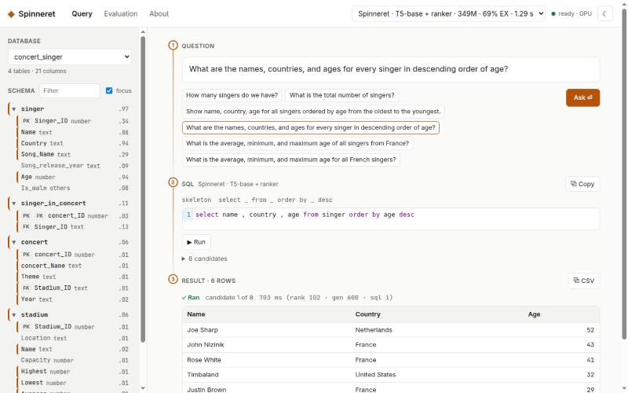

# Spinneret

Small, fast text-to-SQL. Spinneret translates plain-English questions into executable SQL for a given SQLite database, using fine-tuned T5 models and a schema ranker, trained on the [Spider](https://yale-lily.github.io/spider) benchmark.

| Tier | Models | Spider dev EX | Latency (p50, laptop GPU) |
|---|---|---|---|
| Baseline | T5-small, full schema | 49.2% | 0.37 s |
| Lite | T5-small + RoBERTa-base schema ranker | 55.8% | 0.39 s |
| Spinneret | T5-base + the same ranker, skeleton-first | **68.8%** | 1.29 s |

Execution accuracy with the official test-suite evaluation on Spider dev (1,034 questions, 20 databases unseen in training); full tables, ablations and failure analysis in [reports/summary/summary.md](reports/summary/summary.md). Docs: [PRD](docs/prd.md), [specs](docs/specs.md), [design](docs/design.md), [model cards](docs/model-cards/).



## Run the demo

Needs [uv](https://docs.astral.sh/uv/) and Node 20+. A GPU is used if present (about 2 GB); the CPU works, more slowly.

```bash
uv sync --extra train --extra api   # Python 3.12 environment
uv run spinneret download           # Spider 1.0 databases (CC BY-SA 4.0)
(cd web && npm ci && npm run build) # the web app, served by the API
uv run spinneret serve              # http://localhost:8000
```

The first start downloads the three models and the ranker from the Hugging Face Hub (about 1.6 GB; the model repositories are private until release, so this needs access for now) and warms them up; the page shows "warming up" until they are ready. For frontend work, run `npm run dev` in `web/` (Vite on :5173, proxying `/api` to :8000).

## Develop

```bash
uv run spinneret prepare     # processed splits + stats into data/processed
uv run pytest -m "not slow"  # Python tests
(cd web && npm test)         # component tests
```

## Train, predict, evaluate

```bash
uv run spinneret audit-tokenizer                                   # tokens T5 is missing (<, <=)
uv run spinneret train --config configs/t5_small.yaml              # T1; add --resume hub to continue
uv run spinneret train-ranker --config configs/ranker.yaml         # schema ranker
uv run spinneret build-ranked --config configs/t5_small_ranked.yaml  # ranked inputs for T2/T3
uv run spinneret predict --checkpoint hub:iteshxt/spinneret-t5-small --split dev --decoding eg
uv run spinneret evaluate --run reports/<run_id>                   # official EM / EX per difficulty
uv run spinneret analyze --run reports/<run_id>                    # failure taxonomy, question types
uv run spinneret latency --checkpoint <ref> --out reports/<run_id> # per-stage latency, batch 1
uv run spinneret summarize                                         # reports/summary/summary.md
uv run spinneret model-cards                                       # docs/model-cards/*.md
```

Training runs print one JSON line per step/epoch; checkpoints are pushed to the (private) Hugging Face repo in the config after every epoch, so `--resume hub` continues an interrupted run.

### If PyPI downloads crawl

Some networks throttle PyPI's file CDN. Install the exact locked versions from a mirror instead — the SHA-256 hashes in `uv.lock` are enforced, so any file that differs from PyPI's is rejected:

```bash
uv export --frozen --format requirements.txt --no-emit-project --group dev -o /tmp/req.txt
uv venv --python 3.12
uv pip install --require-hashes -r /tmp/req.txt \
  --index https://mirrors.aliyun.com/pypi/simple/ --index https://pypi.tuna.tsinghua.edu.cn/simple \
  --default-index https://pypi.org/simple --index-strategy unsafe-first-match
uv pip install --no-deps -e .
uv sync --frozen --offline    # confirms the environment matches uv.lock
```

Then use `uv run --frozen …`.

## Training on Colab or Kaggle

Training runs on a free Colab T4, driven from this machine with Google's [Colab CLI](https://github.com/googlecolab/google-colab-cli) (`uv tool install git+https://github.com/googlecolab/google-colab-cli`, then log in once with `colab new`):

```bash
scripts/colab/start.sh t1                    # T4 session + code + HF login file + bootstrap
scripts/colab/train.sh t1 <run> <spinneret args…>   # background job on the VM
scripts/colab/logs.sh t1 <run>               # follow it
scripts/colab/stop.sh t1                     # release the GPU
```

When Colab has no GPU free, the same runs go to a free Kaggle T4 with the Kaggle CLI (`scripts/kaggle/`, specs §5.10):

```bash
scripts/kaggle/dataset.sh                                  # private dataset: code + prepared data
scripts/kaggle/push.sh e4 --config configs/ablations/e4_t2_no_skeleton.yaml
kaggle kernels status <user>/spinneret-e4
```

## Data licence

Spider is distributed under [CC BY-SA 4.0](https://creativecommons.org/licenses/by-sa/4.0/) by Yu et al. (EMNLP 2018). It is downloaded by script and never committed to this repository.
