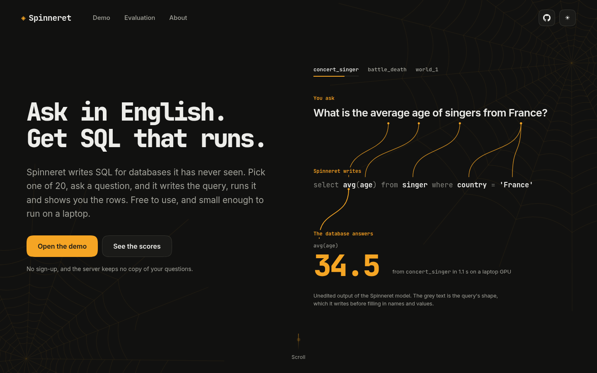
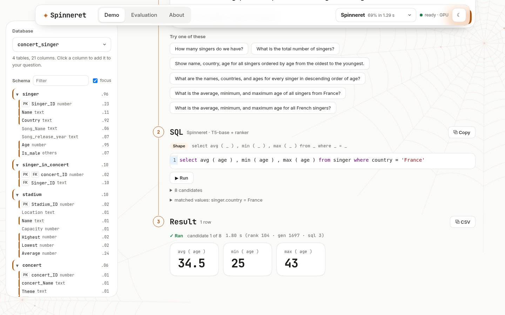
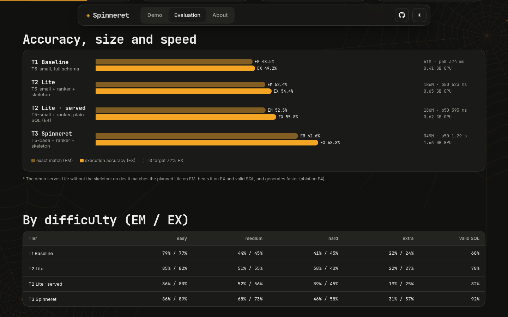

# Spinneret

**Ask a question in plain English and get SQL that runs.** Spinneret writes SQL for SQLite databases it has never seen, using fine-tuned T5 models and a schema ranker trained on the [Spider](https://yale-lily.github.io/spider) benchmark. Every model is small enough to run on a laptop GPU, and the whole thing runs on your own machine.

[](LICENSE)

**Live demo: [spinneret-mu.vercel.app](https://spinneret-mu.vercel.app).** The models run on the author's laptop GPU, so asking questions works while it is on; the rest of the site (databases, example questions, evaluation, model cards) is always up.



## What it does

You pick one of Spider's 20 held-out databases, type a question, and Spinneret:

1. looks up database values that appear in the question, so `France` is spelled the way the database spells it;
2. scores every table and column with a RoBERTa ranker and keeps the most relevant ones (Lite and Spinneret);
3. writes several candidate queries with beam search, the query's shape first (Spinneret);
4. runs them read-only and shows you the first one that works, with its rows.

| Model | What it is | Spider dev EX | Median time (laptop GPU) |
|---|---|---|---|
| Baseline | T5-small, reads the whole schema | 49.2% | 0.37 s |
| Lite | T5-small + RoBERTa-base schema ranker | 55.8% | 0.39 s |
| Spinneret | T5-base + the same ranker, skeleton-first | **68.8%** | 1.29 s |

Execution accuracy with the official test-suite evaluation on Spider dev (1,034 questions over 20 databases none of the models saw in training), on a GTX 1650 with 4 GB. All three models fit in that card together (about 1.6 GB). Full tables, ablations and failure analysis are in [reports/summary/summary.md](reports/summary/summary.md) and on the demo's Evaluation page.

## The demo



- **Ask** in plain English, or start from one of each database's example questions.
- **See why**: the sidebar shows the ranker's score for every table and column, and which ones the model was given.
- **Check the SQL**: the query's shape, the full SQL in an editor you can change and re-run, all eight candidates, and the values that were matched.
- **Switch models** at any time to compare speed and accuracy.
- **Read the evaluation**: accuracy by difficulty and question type, ablations, and a failure taxonomy with examples.



Queries are read-only (one `SELECT`/`WITH` statement, a read-only connection, 5-second limit, 500 rows at most). The server keeps no copy of your questions, and the page loads nothing from other sites; the demo's Privacy and data page (`/privacy`) has the details.

## Run it

Needs [uv](https://docs.astral.sh/uv/) and Node 20+. A GPU is used if present (about 2 GB); the CPU works, more slowly.

```bash
uv sync --extra train --extra api   # Python 3.12 environment
uv run spinneret download           # Spider 1.0 databases (CC BY-SA 4.0)
(cd web && npm ci && npm run build) # the web app, served by the API
uv run spinneret serve              # http://localhost:8000
```

The first start downloads the three models and the ranker from the Hugging Face Hub (about 1.6 GB) and warms them up; the demo shows "warming up" until they are ready. No account or token is needed: the models are public.

| Page | Address |
|---|---|
| Home | `http://localhost:8000/` |
| Demo | `/query` (add `?db=world_1&q=…` to open a database and ask straight away) |
| Evaluation | `/evaluation` |
| About the models | `/about` |
| Privacy and data | `/privacy` |

For frontend work, run `npm run dev` in `web/` (Vite on :5173, proxying `/api` to :8000).

## Host it from your laptop

The public demo is a static site on Vercel's free plan; its live server is this laptop, reached through a free [Tailscale Funnel](https://tailscale.com/kb/1223/funnel) at a fixed `https://<machine>.<tailnet>.ts.net` address. Questions go from the visitor's browser straight to the laptop (TLS ends on the laptop), and while it is off the site shows saved copies of everything except live answers. Design §13 has the reasoning, including why free cloud hosts didn't fit.

One-time setup:

```bash
curl -fsSL https://tailscale.com/install.sh | sh   # install Tailscale
sudo tailscale up                                  # log in (a free personal account)
sudo tailscale set --operator=$USER                # let the script open the funnel without sudo
```

Then, whenever the demo should be live:

```bash
scripts/host/serve.sh   # opens the funnel, serves on 127.0.0.1:8000, Ctrl-C closes both
```

The first run prints a link to allow Funnel for your tailnet, then the `https://….ts.net` address. The hosted site is built with `VITE_HOSTED=1` and `VITE_API_URL` set to that address (Vercel project settings), and the site's own address must be in `cors_origins` in `configs/serve.yaml`. After the evaluation reports change, refresh the site's saved copy with `uv run spinneret snapshot` (a test fails while it is stale).

## How it's built

| Part | Where | Stack |
|---|---|---|
| Data pipeline, training, evaluation | `spinneret/` | Python 3.12, PyTorch, Hugging Face Transformers |
| API | `spinneret/api/` | FastAPI; models load once in the background and run one request at a time |
| Web app | `web/` | Vite, React 18, TypeScript, TanStack Query, Framer Motion, CodeMirror |
| Docs | `docs/` | [PRD](docs/prd.md), [specs](docs/specs.md), [design](docs/design.md), [model cards](docs/model-cards/) |
| Model weights | [huggingface.co/iteshxt](https://huggingface.co/iteshxt) | the three served models, the ranker, and the evaluation-only checkpoints, each with a model card |

## Develop

```bash
uv run spinneret prepare     # processed splits + stats into data/processed
uv run pytest -m "not slow"  # Python tests
(cd web && npm test)         # component tests
```

## Train, predict, evaluate

```bash
uv run spinneret audit-tokenizer                                   # tokens T5 is missing (<, <=)
uv run spinneret train --config configs/t5_small.yaml              # T1; add --resume hub to continue
uv run spinneret train-ranker --config configs/ranker.yaml         # schema ranker
uv run spinneret build-ranked --config configs/t5_small_ranked.yaml  # ranked inputs for T2/T3
uv run spinneret predict --checkpoint hub:iteshxt/spinneret-t5-small --split dev --decoding eg
uv run spinneret evaluate --run reports/<run_id>                   # official EM / EX per difficulty
uv run spinneret analyze --run reports/<run_id>                    # failure taxonomy, question types
uv run spinneret latency --checkpoint <ref> --out reports/<run_id> # per-stage latency, batch 1
uv run spinneret summarize                                         # reports/summary/summary.md
uv run spinneret model-cards                                       # docs/model-cards/*.md
```

Training runs print one JSON line per step/epoch; checkpoints are pushed to the Hugging Face repo in the config after every epoch (created private; switch it to public when you release it), so `--resume hub` continues an interrupted run.

### If PyPI downloads crawl

Some networks throttle PyPI's file CDN. Install the exact locked versions from a mirror instead — the SHA-256 hashes in `uv.lock` are enforced, so any file that differs from PyPI's is rejected:

```bash
uv export --frozen --format requirements.txt --no-emit-project --group dev -o /tmp/req.txt
uv venv --python 3.12
uv pip install --require-hashes -r /tmp/req.txt \
  --index https://mirrors.aliyun.com/pypi/simple/ --index https://pypi.tuna.tsinghua.edu.cn/simple \
  --default-index https://pypi.org/simple --index-strategy unsafe-first-match
uv pip install --no-deps -e .
uv sync --frozen --offline    # confirms the environment matches uv.lock
```

Then use `uv run --frozen …`.

## Training on Colab or Kaggle

Training runs on a free Colab T4, driven from this machine with Google's [Colab CLI](https://github.com/googlecolab/google-colab-cli) (`uv tool install git+https://github.com/googlecolab/google-colab-cli`, then log in once with `colab new`):

```bash
scripts/colab/start.sh t1                    # T4 session + code + HF login file + bootstrap
scripts/colab/train.sh t1 <run> <spinneret args…>   # background job on the VM
scripts/colab/logs.sh t1 <run>               # follow it
scripts/colab/stop.sh t1                     # release the GPU
```

When Colab has no GPU free, the same runs go to a free Kaggle T4 with the Kaggle CLI (`scripts/kaggle/`, specs §5.10):

```bash
scripts/kaggle/dataset.sh                                  # private dataset: code + prepared data
scripts/kaggle/push.sh e4 --config configs/ablations/e4_t2_no_skeleton.yaml
kaggle kernels status <user>/spinneret-e4
```

## Licence

The code in this repository is released under the [MIT licence](LICENSE).

Spider is distributed under [CC BY-SA 4.0](https://creativecommons.org/licenses/by-sa/4.0/) by Yu et al. (EMNLP 2018). It is downloaded by script and never committed to this repository. The trained model weights are derived from Spider and are released under CC BY-SA 4.0 as well (see the [model cards](docs/model-cards/)). Evaluation uses the official [test-suite-sql-eval](https://github.com/taoyds/test-suite-sql-eval) scripts (Apache-2.0); the base models are T5 (Apache-2.0) and RoBERTa (MIT).
