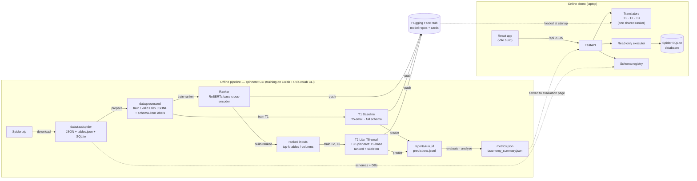
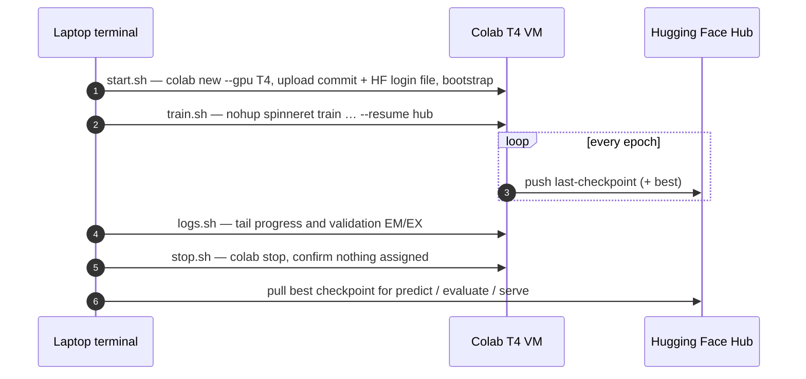
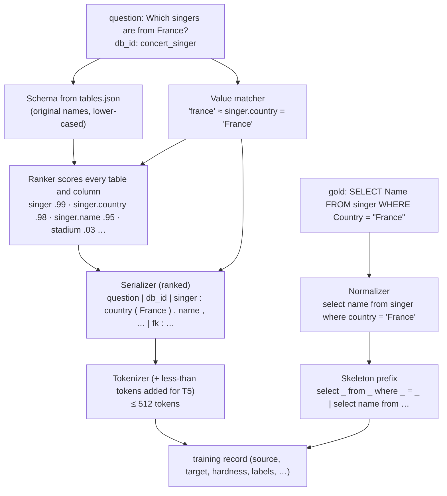
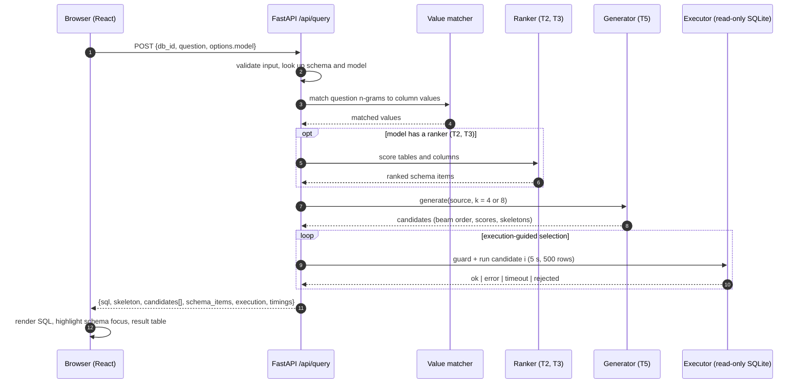
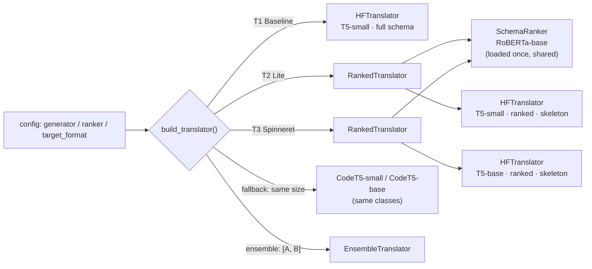
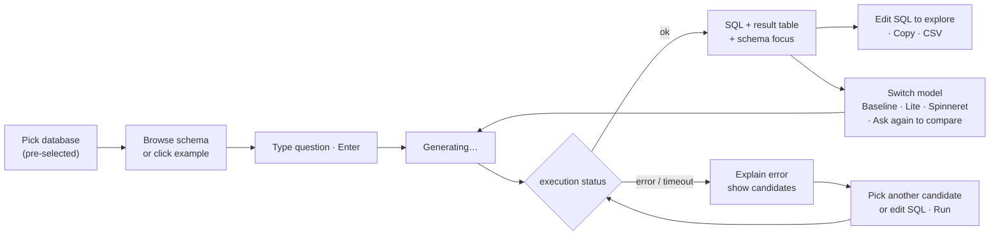

# Spinneret — Design Document

| | |
|---|---|
| **Status** | Draft v3 — tiers Baseline · Lite · Spinneret, shared RoBERTa-base ranker, Colab CLI training, Hugging Face Hub |
| **Companion docs** | [prd.md](prd.md) (what and why) · [specs.md](specs.md) (exact formats, rules and interfaces) |
| **Covers** | Part A — system architecture (§1–§7) · Part B — UI/UX of the demo (§8–§12) · runtime and decisions (§13–§14) |

---

# Part A — System architecture

## 1. Design goals and principles

1. **One code path for training and serving.** The serializer, value matcher, ranker, SQL normalizer and executor used to build training data are the *same functions* the API calls at request time. Differences between training and serving inputs are a classic silent failure in ML systems. Here they are impossible by construction.
2. **Tiers share one pipeline.** T1 Baseline (T5-small), T2 Lite (T5-small + ranker + skeleton) and T3 Spinneret (T5-base + the same ranker + skeleton) differ only in config. T1 → T2 measures the technique, T2 → T3 measures model size — never different plumbing.
3. **Small and fast first.** Accuracy comes from a cheap ranker rather than a big generator. All three tiers together fit in ~1.6 GB of GPU memory, and the ranker is loaded once and shared.
4. **Swappable models behind one interface.** Everything downstream talks to a `Translator`, never to T5 directly. T5, CodeT5, a ranked pipeline or an ensemble are config choices.
5. **Execution is the source of truth.** Candidates are checked by running them. Results are judged by what they return, and EM is reported as the comparable literature metric.
6. **Safe by default.** Databases are opened read-only, every statement is guarded, and every query has a timeout and a row cap. The demo cannot damage data even with hand-edited SQL.
7. **Fits student hardware.** Training on the free Colab T4, launched from the laptop terminal with the Colab CLI and made resumable through the Hugging Face Hub; serving on the laptop. One Python server and one static frontend; SQLite.
8. **Every number is traceable.** Each reported metric comes from a saved predictions file, which came from a checkpoint (local and on the Hub), which came from a saved config.

## 2. System overview

Spinneret has two halves that share one Python package: an **offline pipeline** (CLI commands that build data, train, predict, evaluate and publish) and an **online demo** (FastAPI + React).



## 3. Offline pipeline

| Stage | Where | Input | Output | Key logic (spec reference) |
|---|---|---|---|---|
| `download` | laptop + Colab VM | Spider Google Drive file (mirror fallback) | `data/raw/spider/` | file checks ([specs §4.1](specs.md#41-source-spider-10)) |
| `prepare` | laptop + Colab VM | raw JSON, `tables.json`, databases | `train/valid/dev.jsonl`, `stats.json`, value cache | split by database, serialization, values, normalization, difficulty, schema-item labels (specs §4.2–§4.9) |
| `audit-tokenizer` | laptop | processed JSONL | `added_tokens.json` | round-trip check (specs §4.7) |
| `train` T1 | Colab (laptop fallback) | processed JSONL + config | checkpoint pushed to Hub | Seq2SeqTrainer, validation EM/EX each epoch (specs §5.2) |
| `train-ranker` | Colab | processed JSONL + labels | ranker checkpoint pushed to Hub | RoBERTa-base cross-encoder, focal loss, coverage-based selection (specs §5.5) |
| `build-ranked` | Colab | ranker + processed JSONL | `processed/ranked/<ranker_run>/` | top-k + FKs; gold force-include for training only (specs §5.6) |
| `train` T2, T3 | Colab | ranked JSONL + config | checkpoints pushed to Hub every epoch | skeleton targets (specs §5.7); resumable via `--resume hub` (specs §5.8) |
| `predict` | laptop | checkpoint(s) + split | `predictions.jsonl`, `pred.txt` | beam search + execution-guided selection (specs §6) |
| `evaluate` | laptop | predictions | `metrics.json` | official Spider scripts + ranker coverage (specs §8.1) |
| `analyze` | laptop | one or more runs | taxonomy, question-type and ablation tables | specs §8.3–§8.5 |
| `push` | laptop / Colab | best checkpoint | Hub repo + model card | specs §5.8 |

**Running a stage on Colab** (specs §5.9): `scripts/colab/start.sh` opens a T4 session, ships the current commit and the Hugging Face login file, and bootstraps the VM; `train.sh` starts a `spinneret` command in the background there; `logs.sh` follows it; `stop.sh` releases the GPU. Checkpoints go to the Hub every epoch, so nothing is lost when a free session ends.



How one example moves through the data stages (T2/T3 path; T1 skips the ranker and skeleton):



## 4. Online request flow



Editing SQL in the UI calls `POST /api/execute`, which goes straight to the executor with the same guard, timeout and row cap.

## 5. Components and interfaces

### 5.1 Python package modules

| Module | Responsibility | Used by |
|---|---|---|
| `data.spider`, `data.schema` | Load Spider JSON and `tables.json` into typed `Schema` objects | prepare, API |
| `data.labels` | Gold tables/columns per example from the parsed `sql` field | prepare, ranker, taxonomy |
| `data.serialize` | `serialize(question, schema \| ranked_schema, values) -> str` within 512 tokens | prepare, predict, API |
| `data.values` | `ValueMatcher.match(question, db_id) -> dict[col, list[value]]` with per-DB cache | prepare, ranker, predict, API |
| `data.normalize`, `data.skeleton` | target normalization; skeleton build and output parsing | prepare, translator |
| `ranker.*` | dataset, model, training, `SchemaRanker.rank()` | train-ranker, prepare (ranked inputs), API |
| `model.translator` | `Translator` protocol, `HFTranslator`, `RankedTranslator` | train (validation), predict, API |
| `model.ensemble` | `EnsembleTranslator` (MAY) | predict, API |
| `decoding.execution_guided` | `select(candidates, executor, db_id) -> Selection` | predict, API |
| `db.guard`, `db.executor` | statement guard; read-only execution with timeout and row cap | everything that runs SQL |
| `eval.*` | official-script wrapper, coverage, taxonomy, analysis tables | evaluate, analyze |
| `hub` | push/pull checkpoints, render model cards, `hub:` path resolution | train, push, API |
| `api.*` | FastAPI app, routes, pydantic models, model and schema registries | serve |

### 5.2 Core interfaces

```python
class Translator(Protocol):
    name: str
    def generate(self, question: str, db_id: str, k: int) -> list[Candidate]: ...

class SchemaRanker:
    def rank(self, question: str, db_id: str) -> RankedSchema: ...   # every item with a score

class RankedTranslator(Translator):            # T2 Lite, T3 Spinneret
    def __init__(self, ranker: SchemaRanker, generator: HFTranslator,
                 top_k_tables: int = 4, top_k_columns: int = 5): ...

class SchemaRegistry:
    def list(self) -> list[DatabaseSummary]: ...
    def get(self, db_id: str) -> Schema: ...                         # raises UnknownDatabase

class Executor:
    def run(self, db_id: str, sql: str, *,
            timeout_s: float = 5.0, max_rows: int = 500) -> ExecutionResult: ...

def select(candidates: list[Candidate], executor: Executor, db_id: str) -> Selection: ...
```

`ExecutionResult` carries `status`, `columns`, `rows`, `row_count`, `truncated` and `error`. `Selection` carries the chosen candidate, its rank, every candidate's status and the result. The exact JSON shapes are in [specs §9](specs.md#9-backend-api-fastapi).

### 5.3 Dependency direction

```
api ──► model.translator ──► ranker.infer ──► data.serialize / data.values ──► data.schema
 │                       └─► data.skeleton
 ├────► decoding.execution_guided ──► db.executor ──► db.guard
 ├────► hub
 └────► eval (read-only: metrics files)
```

Lower layers never import higher ones. `data` and `db` have no dependency on PyTorch, so the guard, executor, serializer and skeleton tests run in milliseconds without a GPU.

## 6. Model tiers, swapping and ensemble



- **The trade-off is a config choice.** Lite and Spinneret differ only in the generator checkpoint; the demo can switch between them per request, and the evaluation page shows accuracy next to latency and memory for each.
- **T5 → CodeT5:** both load through `AutoTokenizer` / `AutoModelForSeq2SeqLM`. The only model-specific step is the tokenizer audit: T5 gets `<` and `<=` added, CodeT5 gets nothing. Gate B in [specs §5.1](specs.md#51-models) decides whether to switch.
- **Ranker is a separate model** with its own checkpoint, so it can be retrained, re-tuned (*k*) or upgraded (base → large, Gate A) without retraining the generators — inference-time *k* is an ablation (E5) for free.
- **Ensemble (MAY):** pool candidates from every member, execute each, group candidates whose results are identical, and return the largest group (ties broken by summed log-probability). Voting on execution results, rather than SQL strings, lets two models that write the same query differently agree. Because it implements `Translator`, the API and evaluation code do not change.

## 7. Safety and error handling

| Layer | Protection | Failure behaviour |
|---|---|---|
| Input | question 1–500 characters; SQL ≤ 5,000 characters; `db_id` and `model` must exist | 400 / 404 with `{error: {code, message}}` |
| Guard | one statement; starts with `SELECT`/`WITH`; no write or admin keyword tokens | status `rejected` with a plain-language message |
| Connection | `mode=ro` URI + `PRAGMA query_only = ON` | any write raises → status `error` |
| Runtime | 5 s progress-handler timeout; 500-row cap | status `timeout`; `truncated: true` |
| Generation | no candidate executes | top candidate returned with status `failed` and the SQLite error |
| Startup | models still loading / downloading from the Hub | 503 `model_loading`; UI shows "warming up" and retries |
| Secrets | Hub token only in the local login and Colab secrets | nothing to leak from the repo, configs or logs |

The read-only connection is the actual guarantee. The guard exists to give a clear message ("only read-only SELECT queries can run") instead of a raw SQLite error.

---

# Part B — UI/UX

## 8. UI principles and information architecture

**Who it's for:** an evaluator or recruiter trying the demo for 2 minutes, and me inspecting model behaviour. The UI must make the pipeline *visible* (question → focus → SQL → result) and make failures easy to read, not hide them.

**Principles**

1. **Show the thread.** The stages (question, SQL, result) are stacked vertically in reading order, connected by a thin "silk" line. Each stage is a clearly labelled panel.
2. **Schema always in view — and the model's focus on it.** The schema explorer stays on screen; with Lite and Spinneret, the tables and columns the ranker kept are highlighted with their scores, so users can see *why* the SQL looks the way it does.
3. **Compare, don't just claim.** A model switcher lets anyone run the same question on Baseline, Lite and Spinneret, with each model's size, dev accuracy and speed shown in the switcher.
4. **Honest about uncertainty.** Show which beam candidate was chosen and whether it ran. Errors are explained in plain language, with the raw SQLite message available.
5. **Fast to try.** A database and Spinneret (T3) are pre-selected and example questions are one click away. The first answer should take under 10 seconds from page load.
6. **Developer-grade details.** Monospace SQL with syntax highlighting, the skeleton line, copy buttons, timings and model id — details that show craft.

**Site map**

| Route | Page | Purpose |
|---|---|---|
| `/` | Landing | what Spinneret does in one screen: a real question threaded to its SQL, the four pipeline steps, the three models' speed/accuracy trade-off, example questions that open the demo, how to run it locally |
| `/query` | Query workspace | the demo (`?db=`, `?model=`, and `?q=` to ask a question on load; old `/?db=…` links redirect here) |
| `/evaluation` | Evaluation | tier comparison, difficulty breakdown, ablations, failure taxonomy |
| `/about` | About / model cards | what Spinneret is, how each tier was trained, limitations, links to the Hub, docs and repo |
| `/privacy` | Privacy and data | what the demo sends, what the server keeps (nothing), what stays in the browser, how queries are limited |

## 9. Query workspace layout

### 9.1 Desktop (≥ 1024 px)

```
┌─────────────────────────────────────────────────────────────────────────────────────────┐
│ ◈ Spinneret     Query  Evaluation  About      Model [ Spinneret · T5-base + ranker ▾ ] ● │  header 56px
├───────────────────────────┬─────────────────────────────────────────────────────────────┤
│ DATABASE                  │  ① QUESTION                                                 │
│ [ concert_singer      ▾ ] │  ┌───────────────────────────────────────────────────────┐  │
│ 4 tables · 21 columns     │  │ Which singers are from France?                        │  │
│                           │  └───────────────────────────────────────────────────────┘  │
│ SCHEMA   [filter]  ☑ focus│   Try: [How many singers do we have?] [Average age…]  [Ask ⏎]│
│ ▾ singer           ▌ .99  │  │                                                          │
│    PK singer_id    number │  ② SQL                                      ⧉ Copy  ▶ Run   │
│    ▌ name    text    .95  │   skeleton  select _ from _ where _ = _                     │
│    ▌ country text    .98  │  ┌───────────────────────────────────────────────────────┐  │
│      song_name     text   │  │ select name from singer where country = 'France'      │  │
│      age           number │  └───────────────────────────────────────────────────────┘  │
│ ▸ concert            .04  │  ✓ Ran · candidate 1 of 8 · 735 ms (rank 38 · gen 690 · sql 3)│
│ ▸ stadium            .03  │  ▸ 8 candidates   ▸ matched values: singer.country = France  │
│ ▸ singer_in_concert  .02  │  │                                                          │
│                           │  ③ RESULT · 1 row                                  ⧉ CSV     │
│ HISTORY (this session)    │  ┌───────────────────────────────────────────────────────┐  │
│ • Which singers are fr…   │  │ name                                                  │  │
│ • How many singers do…    │  │ Joe Sharp                                             │  │
│                           │  └───────────────────────────────────────────────────────┘  │
└───────────────────────────┴─────────────────────────────────────────────────────────────┘
   sidebar 300px, scrolls independently            workspace max-width 880px
   ▌ = kept by the ranker (accent bar + score); items it filtered out are dimmed
```

### 9.2 Mobile (< 768 px)

The sidebar collapses into a **Database & schema** sheet opened from a button under the header; the model switcher moves into the same sheet. The panels stack full-width, wide result tables scroll horizontally inside their own container (never the page), and history moves into the sheet.

### 9.3 Components

| Component | Behaviour |
|---|---|
| `ModelSwitcher` | Select between the models in `/api/models`: **Spinneret** (T3, default), **Lite** (T2, fast mode), **Baseline** (T1). Each option shows size, dev EX and typical latency, e.g. "Lite · 185M · 58% · 0.4 s" (values from the latest evaluation). Changing it keeps the question and database; the next Ask uses the new model. The header shows the active model and device. |
| `DatabasePicker` | Searchable select of the 20 dev databases; shows table/column counts. Changing it clears the result and loads new examples. |
| `SchemaExplorer` | Collapsible tables; columns with type; `PK`/`FK` badges; FK target on hover/focus; filter box. **Focus mode** (Lite and Spinneret, on by default after an answer): kept items get an accent bar and score, filtered-out items are dimmed, kept tables auto-expand. Clicking a column inserts its name into the question at the cursor. |
| `QuestionInput` | Auto-growing textarea, 500-character limit with counter near the limit. `Enter` submits, `Shift+Enter` adds a new line. |
| `ExampleChips` | Up to 6 dev questions for the selected database; click fills the question and submits. |
| `SkeletonLine` | Lite and Spinneret: the generated skeleton in muted monospace above the SQL. |
| `SqlPanel` | CodeMirror with SQL highlighting, read-write. After an edit, shows an **Edited** badge and **Run** runs it via `/api/execute`. **Reset** restores the generated SQL. Copy button. |
| `StatusLine` | Icon + text for the status, chosen candidate rank, timings split into ranking / generation / SQL. |
| `CandidatesList` | Expandable list of beams with score and status (`ran ✓`, `error`, `not run`). Clicking one loads it into the SQL panel and runs it. |
| `ResultTable` | Sticky header, monospace numbers right-aligned, `NULL` shown greyed, row count, "showing first 500 rows" notice, copy as CSV. |
| `HistoryList` | Last 20 questions this session with the model used; clicking restores question, model, SQL and result (re-runs the SQL). |

## 10. States and interaction flows

### 10.1 Workspace states

| State | What the user sees |
|---|---|
| **Warming up** (API 503) | Header dot amber "warming up"; Ask disabled; automatic retry every 2 s. |
| **Backend unreachable** | Full-width banner: "Can't reach the Spinneret server. Is `spinneret serve` running?" + Retry. |
| **Ready / empty** | Question box focused, example chips visible, SQL and Result panels show one-line hints ("Your SQL will appear here"). |
| **Generating** | Ask button shows a spinner and "Spinning…"; SQL panel shows a skeleton loader; earlier result is dimmed, not removed. |
| **Success** | SQL (+ skeleton for Lite/Spinneret), green status line, result table, schema focus highlighted. Focus moves to the result heading (announced via `aria-live`). |
| **Success, 0 rows** | Status green; result panel: "The query ran but no rows matched." This is a valid answer, not an error. |
| **Truncated** | Notice above the table: "Showing the first 500 rows." |
| **SQL error** | Red status: "The generated SQL didn't run." Plain-language reason + expandable raw SQLite error; candidates list auto-expands; SQL panel editable to fix. |
| **Timeout** | Amber status: "Query took longer than 5 s and was stopped." |
| **Rejected** (edited SQL) | Amber status: "Only read-only SELECT queries can run here." |
| **Invalid input** | Inline message under the question box (empty or too long); nothing is sent. |

### 10.2 Main flow — ask a question



### 10.3 Keyboard map

| Key | Action |
|---|---|
| `/` | focus question box |
| `Enter` / `Shift+Enter` | ask / new line (question box) |
| `Ctrl/Cmd+Enter` | run SQL (SQL panel) |
| `M` | open the model switcher |
| `Esc` | close the mobile sheet / candidate list / model switcher |
| `Tab` order | header (incl. model switcher) → database → schema → question → examples → Ask → SQL → candidates → result |

## 11. Evaluation and About pages

### 11.1 Evaluation page (`/evaluation`)

```
┌───────────────────────────────────────────────────────────────────────────┐
│ Evaluation · Spider dev (1,034 questions, 20 unseen databases)            │
│                                                                           │
│ ┌──────────────┐ ┌──────────────┐ ┌──────────────┐ ┌──────────────┐       │
│ │ T3 EX        │ │ T3 EM        │ │ Ranker       │ │ T3 p50       │ ← stat│
│ │ 73.1%        │ │ 66.0%        │ │ coverage 96% │ │ 0.74 s       │  tiles│
│ │ target 72    │ │ target 65    │ │ @ (4,5)      │ │ laptop GPU   │ (ex.  │
│ └──────────────┘ └──────────────┘ └──────────────┘ └──────────────┘ values)│
│                                                                           │
│ Accuracy vs size vs speed (EM / EX)          ┊ = targets 65 EM / 72 EX    │
│  T1 Baseline   60M   ████████▒▒▒▒             ┊      0.3 s   0.24 GB     │
│  T2 Lite      185M   ███████████▒▒▒▒          ┊      0.4 s   0.49 GB     │
│  T3 Spinneret 345M   ██████████████▒▒▒▒▒      ┊      0.7 s   1.15 GB     │
│                                                                           │
│ By difficulty   [ T1 | T2 | T3 ]     By question type   [ T1 | T2 | T3 ] │
│  easy / medium / hard / extra bars       lookup · aggregation · join …    │
│                                                                           │
│ Ablations                                                                 │
│  E2 decoding  greedy → beam → execution-guided      +x / +y               │
│  E3 values    off → on                              +x / +y               │
│  E4 ranker    T1 → T2-no-skeleton                   +x / +y               │
│  E4 skeleton  T2-no-skeleton → T2                   +x / +y               │
│  E7 size      T2 (T5-small) → T3 (T5-base)          +x / +y               │
│  E6 train_others  off → on                          +x / +y               │
│                                                                           │
│ Failure taxonomy (primary label)   tier [ T3 ▾ ]       [ table | chart ]  │
│  Category          Count  Share  ranker_miss  Example                     │
│  join_error          …      …        …        "Show names of singers…" ▸  │
│  wrong_column        …      …        …        …                        ▸  │
└───────────────────────────────────────────────────────────────────────────┘
```

- All numbers in the wireframe are placeholders. Real values come from `GET /api/metrics/{run_id}`.
- The tier comparison puts accuracy, size, latency and memory on one row per tier and draws the T3 targets (65 EM / 72 EX) as a reference line, so the trade-off is visible at a glance.
- Expanding a taxonomy row shows the question, gold SQL and predicted SQL side by side, with differing clauses highlighted, plus the ranker's kept items for Lite/Spinneret.
- Charts: grouped horizontal bars (EM and EX), direct value labels, no legend-hunting. Colours come from §12 so light and dark modes both work.

### 11.2 About page (`/about`)

One model card per tier: purpose; base model and size; training data (Spider incl. `train_others`, CC BY-SA 4.0, with attribution); input format; decoding; headline metrics with a link to the evaluation page; known limitations (unseen-schema errors, ranker misses, wrong values, nested queries, English only, read-only); links to each model's Hugging Face page, to `docs/` and to the repository.

## 12. Visual language, responsiveness, accessibility

### 12.1 Identity

Spinneret's theme is **silk**: a calm neutral canvas with one warm, silk-gold accent used sparingly (primary button, active states, ranker focus bars, the thread line between panels). Status colours are reserved for status only.

### 12.2 Colour tokens

Defined as CSS variables on `:root` and mapped into Tailwind. Dark mode follows `prefers-color-scheme`, with a manual toggle stored per browser.

| Token | Light | Dark | Use |
|---|---|---|---|
| `--bg` | `#FAFAF9` | `#111110` | page background |
| `--surface` | `#FFFFFF` | `#1A1A18` | panels |
| `--surface-2` | `#F3F3F1` | `#232320` | sidebar, table header, code background |
| `--border` | `#E3E3DF` | `#34342F` | panel and table borders |
| `--text` | `#1C1C1A` | `#EDEDE9` | body text |
| `--text-muted` | `#62625C` | `#A3A39B` | labels, hints, skeleton line, dimmed schema items |
| `--accent` | `#B45309` | `#F5A524` | primary action, focus ring, thread line, ranker focus bars |
| `--accent-contrast` | `#FFFFFF` | `#1A1A18` | text on accent |
| `--ok` | `#15803D` | `#4ADE80` | ran successfully |
| `--warn` | `#A16207` | `#FACC15` | timeout, rejected, truncated |
| `--error` | `#B91C1C` | `#F87171` | SQL error, failed |

All text/background pairs above target WCAG AA (≥ 4.5:1 for body text). Contrast MUST be checked with a tool during build, not assumed. Dimmed schema items must still meet 4.5:1 — dimming uses `--text-muted`, not opacity.

### 12.3 Typography and spacing

| Element | Font | Size / weight |
|---|---|---|
| UI text | Inter (fallback: system-ui) | 14 px / 400; labels 12 px / 600 uppercase, tracking +0.04em |
| Question input | Inter | 16 px (avoids mobile zoom) |
| Page titles | Inter | 20 px / 600 |
| SQL, skeleton, schema columns, numbers in tables | JetBrains Mono (fallback: ui-monospace) | 13 px |
| Stat tiles | Inter | 28 px / 600 value, 12 px label |

Spacing on a 4 px scale (4, 8, 12, 16, 24, 32). Radius 8 px for panels, 6 px for inputs and chips. Borders preferred over shadows. Motion is limited to 150 ms fades and the generating spinner, all disabled under `prefers-reduced-motion`.

### 12.4 Responsiveness

| Breakpoint | Layout |
|---|---|
| ≥ 1024 px | sidebar + workspace (§9.1) |
| 768–1023 px | sidebar narrows to 260 px; examples wrap; model switcher label shortens to the tier id |
| < 768 px | single column; schema and model switcher in a sheet (§9.2); 16 px side gutters; no horizontal page scroll (tables scroll inside their container) |

### 12.5 Accessibility checklist

- Every interactive element reachable and operable by keyboard; visible 2 px `--accent` focus ring.
- Landmarks: `header`, `nav`, `aside` (schema), `main` (workspace).
- Result region `aria-live="polite"`; status announced as text, never by colour alone (icon + words).
- Ranker focus conveyed by text too (score and "kept by model" in the accessible name), not only by the accent bar.
- Result table uses real `<table>` markup with `<th scope="col">`.
- CodeMirror editor labelled ("Generated SQL, editable").
- Charts have a text/table alternative (the taxonomy table, the per-difficulty and per-tier numbers).

---

## 13. Runtime and deployment

| Mode | How it runs |
|---|---|
| **Development** | `uv run spinneret serve` (FastAPI on :8000, auto-reload) + `npm run dev` in `web/` (Vite on :5173, proxies `/api`). |
| **Demo build** | `npm run build` → `web/dist/`; `uv run spinneret serve` serves the API at `/api` and the built app at `/` from a single process and port. |
| **Models at startup** | T1, T2 and T3 generators plus the one shared ranker are fetched from the Hub on first run (cached afterwards) or read from local checkpoints; together about 1.6 GB on the GPU (specs §5.3). |
| **Process model** | One uvicorn worker. Ranking and generation run in a thread pool behind one GPU lock, so concurrent requests queue instead of competing for the GPU. One short-lived read-only SQLite connection per request. |
| **Device** | `device: auto` → CUDA if available, else CPU (slower but works on any machine). |
| **Training on Colab** | From the laptop terminal with the Colab CLI and `scripts/colab/` (§3, specs §5.9): a free T4 session runs `download → prepare → train-ranker / build-ranked / train --resume hub` in the background. A checkpoint is pushed to the (private) Hub repo every epoch, so a reclaimed session resumes where it stopped. The demo always runs locally. |

## 14. Design decisions log

| # | Decision | Alternatives considered | Why |
|---|---|---|---|
| D1 | **Three tiers: Baseline (T5-small) → Lite (T5-small + ranker) → Spinneret (T5-base + ranker)**; CodeT5 of the same size as config-switchable fallback | T5-small only; T5-base + RoBERTa-large ranker as the main model; T5-large / T5-3B; LLM prompting | Owner prefers small, fast models with moderate-to-good accuracy. T5-small alone (≈ 46 EX) is too weak; T5-large/3B are too big to load fast and still top out near 67–71 EX; a ranker on a small/base generator gives most of RESDSQL-Base's gain at a fraction of the size. The tiers separate technique (T1 → T2) from size (T2 → T3). |
| D2 | **UnifiedSKG-style serialization** (`question \| db_id \| table : cols \| …`) | graph encoders (RAT-SQL); CREATE TABLE prompts | Proven with T5 on Spider; simple, readable, cheap in tokens. |
| D3 | **BRIDGE-style value matching** (≤ 2 values per column) | no content; full sample rows | Fixes literal spelling for execution while staying within 512 tokens. |
| D4 | **Schema-item ranker: RoBERTa-base** cross-encoder (top 4 tables × 5 columns), shared by Lite and Spinneret; RoBERTa-large only if coverage < 95% | feed the full schema; heuristic string matching; RoBERTa-large by default | Largest single effect in RESDSQL's ablation (removing ranking cost 4.5 EM / 7.8 EX); also removes the 512-token problem. Base size is ~3× cheaper to train and serve; coverage tells us objectively whether it is enough. |
| D5 | **Skeleton-first targets** | plain SQL targets | Cheap to add (a target rewrite), small but positive gain in RESDSQL; makes the query shape visible in the UI. |
| D6 | **Execution-guided candidate selection** | PICARD constrained decoding | Similar goal (no invalid SQL) for a fraction of the complexity; PICARD needs a Haskell parser service. |
| D7 | **Train on `train_spider` + `train_others`** (8,659) | `train_spider` only (7,000) | More training data; an ablation (E6) measures the effect and keeps comparability with baselines that used 7,000. |
| D8 | **Validation split by database** from training data | tune on dev | Keeps dev a true unseen-schema test and comparable with literature. |
| D9 | **Official Spider evaluation scripts** (submodule) | own metric code | Numbers comparable with published results; avoids subtle metric bugs. |
| D10 | **Read-only SQLite + guard + timeout + row cap** | guard only | Read-only connection is a real guarantee; guard gives clear messages. |
| D11 | **FastAPI + React (Vite, TypeScript)** | Gradio; Streamlit; Next.js | Owner's choice; typed API contract; shows full-stack skill; Vite is lighter than Next.js for one SPA. |
| D12 | **Hugging Face Hub for checkpoints** (account `iteshxt`), pushed every epoch during training | local only; Google Drive | Survives Colab session limits (resume from Hub); public model pages for the portfolio; one source for the demo to load from. The login reaches the VM as an uploaded file, never as a command-line value. |
| D13 | **Single-process serving**, models loaded once | separate model server | Simplest thing that meets latency on a laptop. |
| D14 | **fp32 + Adafactor** for T5; **fp16** for the RoBERTa ranker | fp16 for everything | T5 overflows in fp16; RoBERTa is stable in fp16 and the T4 has tensor cores; Adafactor saves optimizer memory. |
| D15 | **uv + Python 3.12** | system Python 3.14; conda | Reliable ML wheels; one lockfile; fast installs. |
| D16 | **Ensemble votes on execution results** (MAY) | vote on SQL strings | Different SQL with the same result counts as agreement. |
| D17 | **Train on the free Colab T4 through the Colab CLI**, wrapped in five small scripts | laptop GPU only; Colab web notebooks; Kaggle CLI | Verified free T4 allocation from the terminal; ~4× the laptop's VRAM; fully scriptable and repeatable from the repo. Scripts isolate the young CLI (v0.8) so changes are one-file fixes; Kaggle and the web UI remain fallbacks. |
